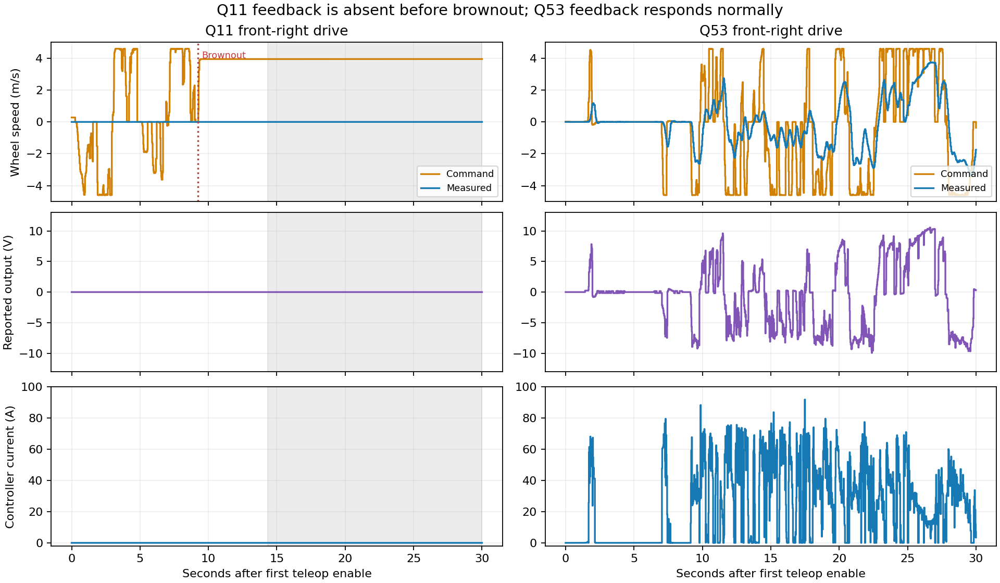

# Front-right drive feedback history: Q11 and the surrounding logs

Reviewed 2026-10-16. Findings are log observations, not confirmation of a failed motor or a particular repair. Module1 maps to front-right in the retained team code revisions; its drive controller is CAN 12. Every relevant competition build reports uncommitted changes, so the base revision is not the exact deployed source.

## What started when, and did it recover?

There are two distinguishable episodes:

1. **January 28: encoder feedback missing, electrical feedback still present.** The first recorded candidate is `akit_26-01-28_16-10-23.wpilog`. Module1 drive position and speed remain zero, but voltage varies about −2.08 to +2.35 V and current reaches 66.81 A. Other modules exceed 1 m/s during 2.399 seconds of enabled operation. Similar behavior appears in the 20-12-13 and 20-12-57 files. This is different from Q11's simultaneous zero voltage/current/position/speed. Normal changing feedback is back in the 20-49-34 file, and the 21-13-49 test contains 29.796 seconds of peer motion with only 0.040 seconds near zero. The logs do not establish a common physical cause for the January and March episodes.
2. **March 12–14: the Q11-style drive-feedback anomaly.** The March 12 22-37-01 file has zero drive position/speed/voltage throughout its readable prefix; current is essentially zero (maximum 0.110 A). It contains 86.488 seconds of enabled peer motion, all with Module1 speed zero. This file eventually has a decode error, so it supports only its decoded prefix. The next file, March 12 23-09-36, independently confirms the same pattern for 185.674 seconds of enabled peer motion without a decode error. Steering telemetry still changes. The preceding March 12 22-34-59 file has near-zero/implausible tiny values and no useful enabled peer motion; it cannot locate a physical failure onset.

The last earlier enabled motion evidence with nonzero Module1 speed is February 26 (`23-10-51`, only 0.340 seconds of qualifying motion). A stronger preceding test is February 25 `23-52-09`: 89.380 seconds of qualifying motion with no near-zero Module1 exposure. The available logs do not show the exact moment of failure between the earlier normal tests and March 12.

**At Tabernacle, it was already present in Q7, remained throughout Q11, and was back to responsive feedback by Q53 on March 15.** Q11 never shows recovery of its six drive scalar fields, even after the radio/DS connection recovers. Its later wheel-motion intervals, including around FPGA 481–548 s, still have Module1 at zero. Q31 is a disabled/prematch-only log and cannot establish a repair time. Recovery is therefore bounded by the last confirmed March 14 anomaly and the March 15 Q53 log; no intervening repair record is available.

## Qualification-match comparison

The exposure below is **enabled time with at least one other module exceeding 1 m/s**, not match duration. Zero feedback means absolute Module1 measured speed below 0.01 m/s. Change-only values are held until their next update; record counts are not time percentages. Short zero intervals around transitions can be normal and are not classified as failures by themselves.

| Event / match | Peer-motion exposure | Module1 near-zero exposure | Interpretation |
| --- | ---: | ---: | --- |
| Tabernacle Q7 | 76.601 s | 76.601 s | Persistent missing drive feedback |
| Tabernacle Q11 | 35.159 s | 35.159 s | Persistent missing drive feedback, before and after communication loss |
| Tabernacle Q31 | 0 s | 0 s | Prematch only; no conclusion |
| Tabernacle Q53 | 32.641 s | 0.040 s | Responsive feedback restored; no zero interval ≥0.5 s |
| Tabernacle Q58 | 11.982 s | 0 s | Responsive feedback |
| Tabernacle Q63 | 33.612 s | 0 s | Responsive feedback |
| Bensalem Q7 | 43.167 s | 0 s | Responsive feedback |
| Bensalem Q34 | 89.552 s | 0.157 s | No sustained zero interval ≥0.5 s |
| Bensalem Q42 | 0 s | 0 s | Unusable for this comparison: near-zero feedback across all four modules and implausible values elsewhere; not evidence of a renewed isolated front-right fault |
| Bensalem Q48 | 111.280 s | 0.357 s | No sustained zero interval ≥0.5 s |
| Bensalem Q53 | 107.557 s | 0.284 s | No sustained zero interval ≥0.5 s |
| Bensalem Q61 | 126.039 s | 0 s | Responsive feedback |

The Bensalem E1/E5 playoff logs also have responsive Module1 feedback, with no sustained zero interval ≥0.5 s under this test. Qualifying motion exists in 41 of the 136 supplied original logs. Nine have invalid headers, and four encountered decode errors in this broader field scan; those are retained as unavailable/prefix-only evidence. No derivative viewing logs were counted.

## Q11 versus the first match showing recovery: Tabernacle Q53

The figure compares the first 30 seconds after each log's first teleop enable; these are different driving tasks, not a matched performance experiment. It uses 20 ms held-value samples, not interpolation. Gray shading marks Q11's DS-disabled interval; the held command during the communication interruption does not mean the controller continued receiving commands. Red marks the first brownout.

| Signal | Q11 | Q53 |
| --- | --- | --- |
| Drive speed | Exactly 0 throughout the file | −3.668 to +3.756 m/s across the file |
| Drive position | Exactly 0 throughout the file | Changes over a range of roughly 22.31 m; range is not total travel |
| Reported controller output | Exactly 0 V | −10.410 to +10.542 V |
| Controller current | Exactly 0 A | 0–91.832 A |
| Measured-speed records | One initial zero, held | 1,551 changing-value records |
| Example while moving | At 416.000 s: commanded ~4.591 m/s, measured 0 | At 180.235015 s: commanded −4.600 m/s, measured −3.143 m/s, −9.194 V, 19.963 A |

Q53 is normal **for availability of this module's feedback**; it is not a claim that the entire robot or speed tuning was ideal. Commands and measured speeds need not agree instantaneously, especially as optimized swerve states reverse wheel direction while steering. The Q53 file ends while enabled and covers only the recorded portion of the match.

Recorded base revisions: Q11 `f0e5fc88cf38aa3a792dafdaf0b42a1e975c38d6`; Q53 `4e4502388...` (full revision in source receipts). The retained `Drive.java`, `DriveConstants.java` and `ModuleIOSparkMax.java` are byte-identical between those base revisions. This weakens a simple explanation based on a committed change to those three files, but cannot exclude dirty-source changes, other software, controller configuration, power/CAN work, or hardware replacement.

## What this changes about the diagnosis

- The Q11 brownout did **not initiate** the persistent front-right feedback anomaly: it was present days earlier and in Q11 before the voltage drop.
- The front-right drive feedback did **not recover with Q11 communications**. Treat the two problems separately unless evidence connects them.
- March's simultaneous zero speed, position, reported voltage and current, while steering and other modules change, warrants checking drive CAN 12's power, CAN communication, configured ID and configuration/read errors. An encoder-only explanation fits January's electrical activity better than March's broadly absent drive feedback.
- Zero log values cannot distinguish an unpowered/unreachable controller, failed reads/default returns, configuration problems, or physical drivetrain failure. Measured swerve states reuse the same encoder inputs and are not an independent measurement of wheel motion.
- For a useful software improvement, log per-controller connection/read status, last error, bus voltage, reset/fault indicators, configuration/setReference results and last successful update time. An explicit invalid/unknown state would be more informative than a plausible-looking zero. Check the actual controller and deployed configuration before changing gains.

## Reproduce and inspect

- `scripts/trace_swerve.py`: scans only original `logs/2026` files; per-file SHA-256, recorded build metadata, scalar ranges, exact exposure and intervals in `analysis/electrical/swerve-history.json`.
- `scripts/compare_swerve.py`: creates the comparison JSON and figure from the two allowlisted trace exports. Plotting uses the root `.venv` with Matplotlib; log scanning uses the robot `.venv` with wpiutil.
- `provenance/swerve-history/sources.json`: immutable team-code revisions, URLs, hashes and retrieval times. Original log hashes are in the history JSON.
- In AdvantageScope, open the Q11 and Q53 originals in separate windows and choose **Swerve Measured vs Setpoint**, **Motor Values**, or **Motor Map** if using their electrical viewing copies. For original files, use the original `/Drive/Module1/...` and `/RealOutputs/SwerveStates/...` fields; derived `/Electrical/...` keys exist only in viewing copies. Q11's 410–425 s focus file cannot demonstrate the earlier onset or later recovery window.
- Inspect Q11 at 416.000 and 495.000 s; inspect Q53 at 180.235 s. Use Module1 position/current/voltage with speed, rather than inferring failure from a single stopped-wheel sample.

No additional video observations or physical repair evidence were created by this analysis.
